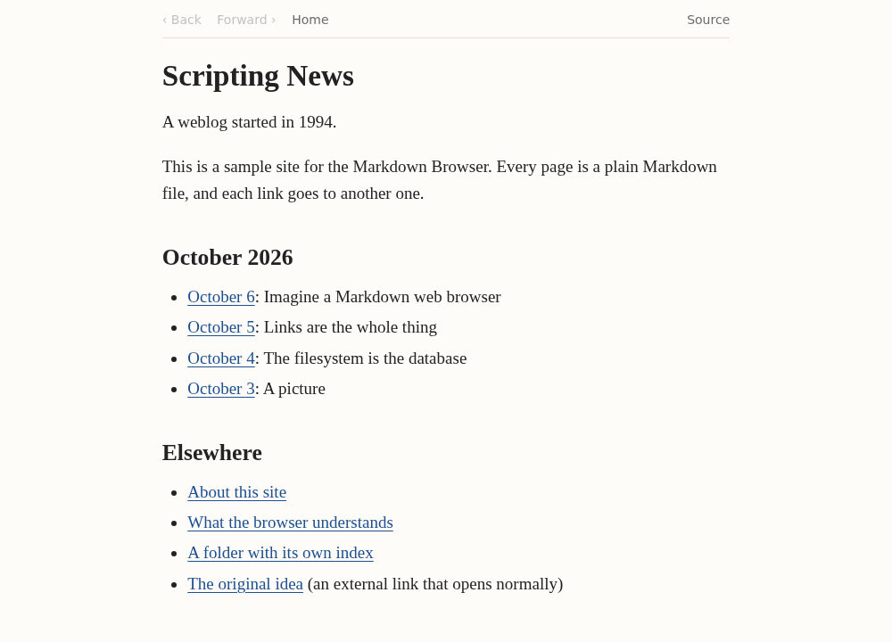
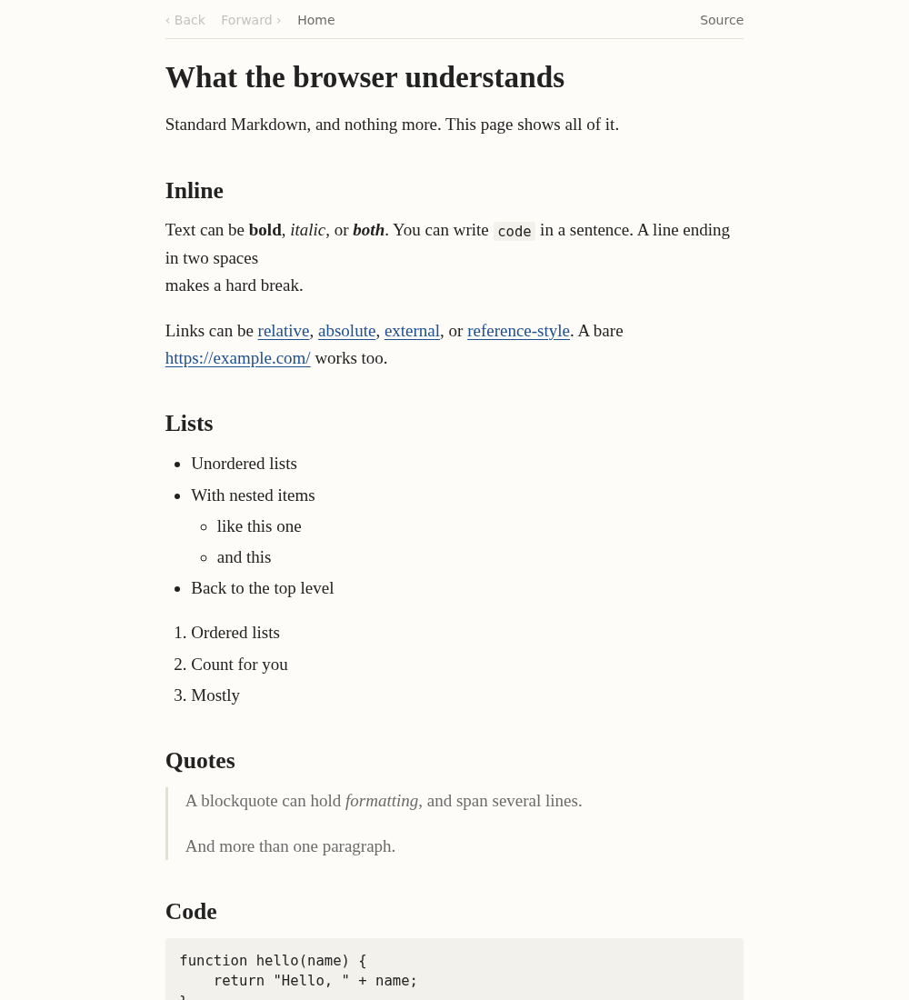
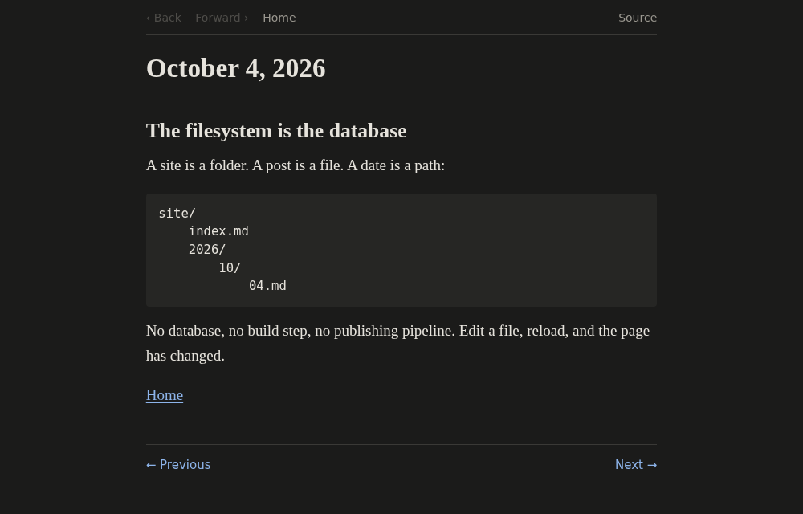
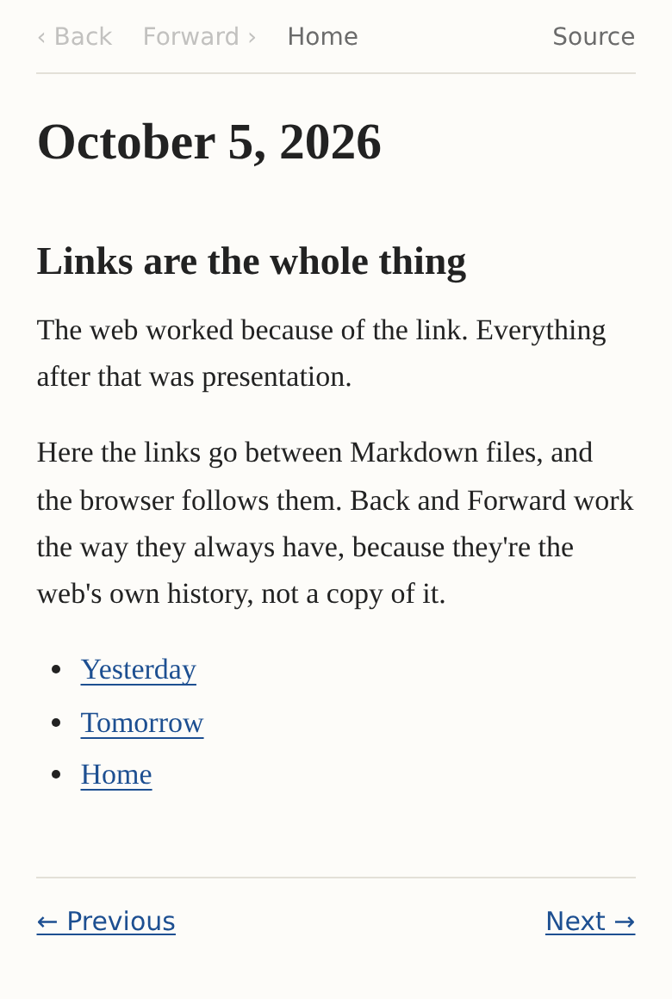

# BrowseMD: a Markdown Browser

A very simple browser whose native document format is Markdown.

The content is Markdown files linked to other Markdown files. The browser understands enough Markdown to render them cleanly and to move between them, with real URLs, working Back and Forward, and reload. The documents themselves have no control over how they look.

This is an implementation of version 0.1 of [Dave Winer's Markdown Browser spec](https://gist.github.com/scripting/c81461104f079b7a017802286853c4f1).



## Screenshots

| Every standard Markdown feature | Dark mode follows the system | Phone width |
|---|---|---|
| [](docs/screenshots/markdown.png) | [](docs/screenshots/post-dark.png) | [](docs/screenshots/mobile.png) |

The small bar at the top is the whole browser chrome: Back, Forward, Home, and Source (the raw Markdown). Previous and Next appear when a document's front matter names them.

## Run it

You need [Node.js](https://nodejs.org/) 18 or later. There are no other dependencies.

```sh
git clone https://github.com/DigitallyAdrift142/BrowseMD.git
cd BrowseMD
npm start
```

Then open <http://localhost:1994/>.

To browse your own folder of Markdown files:

```sh
node server.js ~/path/to/site
```

Or install the `browsemd` command globally:

```sh
npm install -g github:DigitallyAdrift142/BrowseMD
browsemd ~/path/to/site            # or just `browsemd` inside a folder with an index.md
browsemd --port 8080 --host 0.0.0.0
```

To update, run `git pull`, or rerun `npm install -g github:DigitallyAdrift142/BrowseMD`.

## A site

A site is a folder:

```text
site/
	index.md
	about.md
	2026/
		10/
			05.md
			06.md
	images/
		photo.jpg
```

- `/` is `index.md`. `/2026/` is `2026/index.md`.
- Relative links like `[Yesterday](05.md)` or `[Home](../../index.md)` load inside the browser.
- Links to `http://` and `https://` sites behave like ordinary web links.
- Images and other files are served as they are.

Markdown is standard Markdown: headings, paragraphs, bold, italics, links (including reference-style), images, lists, blockquotes, code, code blocks, and horizontal rules. Raw HTML is shown as text.

Front matter is optional. Only a few fields mean anything, and they describe relationships between documents, not presentation:

```markdown
---
title: October 6, 2026
previous: 05.md
next: 07.md
home: /index.md
---
```

Without a `title`, the title is the first `# Heading`, or else the file name.

## How it works

```text
Markdown file -> lib/parseMarkdown.js -> document model -> client/renderHtml.js -> page
```

- **`server.js`** serves the site. Each `.md` URL is one stable address. A browser navigating to it gets the Markdown Browser app. Anything else (`curl`, `fetch`, a feed reader) gets the raw Markdown, and so does `?raw`. Paths can't escape the site folder, and dotfiles aren't served.
- **`lib/parseMarkdown.js`** is the only code that knows Markdown syntax. It turns a file into the document model.
- **`lib/documentModel.js`** defines that model: a small tree of headings, paragraphs, lists, quotes, code, and rules, plus the title, front matter, and every outgoing link. Future renderers (outline, OPML, SVG graph, cards) consume this model and never see Markdown.
- **`client/renderHtml.js`** renders the model as HTML, escaping all text. `javascript:` and other unsafe link schemes are dropped.
- **`client/browser.js`** intercepts clicks on internal Markdown links, fetches and renders the document, and uses the browser's own history (`pushState`/`popstate`). Back, Forward, and Reload keep your scroll position.

There's no framework, no build step, and no database. The parser and model run unchanged in Node, so you can do things like this:

```js
const { parseMarkdown } = require("browsemd/lib/parseMarkdown.js");
const doc = parseMarkdown(fs.readFileSync("site/index.md", "utf8"), "/index.md");
doc.title; // "Scripting News"
doc.links; // [{ href: "2026/10/06.md", text: "October 6" }, ...]
```

## Tests

```sh
npm test
```

## License

MIT
