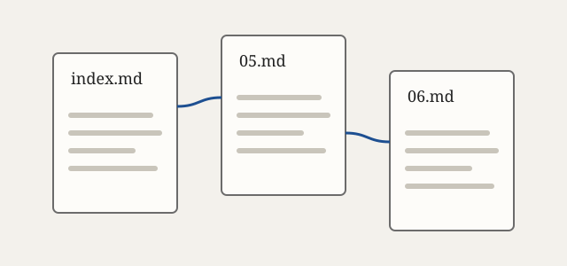

# What the browser understands

Standard Markdown, and nothing more. This page shows all of it.

## Inline

Text can be **bold**, *italic*, or ***both***. You can write `code` in a sentence.
A line ending in two spaces  
makes a hard break.

Links can be [relative](about.md), [absolute](/index.md), [external](https://example.com/), or [reference-style][ref]. A bare <https://example.com/> works too.

[ref]: 2026/10/06.md "October 6"

## Lists

- Unordered lists
- With nested items
  - like this one
  - and this
- Back to the top level

1. Ordered lists
2. Count for you
3. Mostly

## Quotes

> A blockquote can hold *formatting*, and
> span several lines.
>
> And more than one paragraph.

## Code

```javascript
function hello(name) {
	return "Hello, " + name;
}
```

    Indented code blocks work too.

## Images



---

Raw HTML is just text: <b>this isn't bold</b>. Documents can't control how they look.

[Home](index.md)
